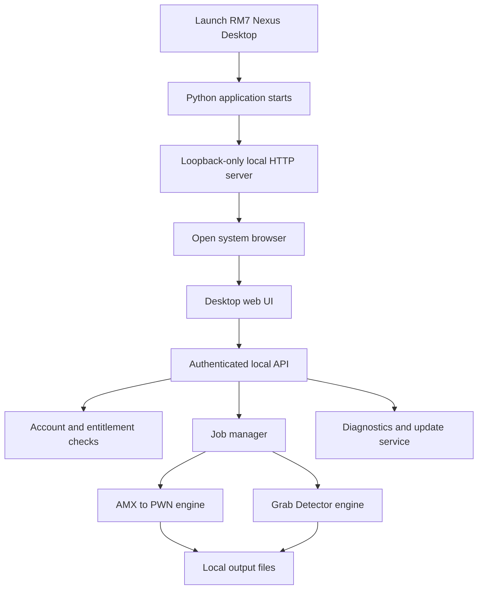

<div align="center">

# ⬡ RM7 NEXUS DESKTOP

### A local desktop control plane for the RM7 Nexus ecosystem

**Analyze Lua scripts · Inspect AMX files · Manage jobs · Authenticate securely · Receive verified updates**

[](#-platform-support)
[](#-technology-stack)
[](#-requirements)
[](#-repository-scope)

[**RM7 Nexus Website**](https://rm7n3xus.vercel.app/) · [**Repository**](https://github.com/Muzanespisito/Rm7-nexus-Desktop) · [**Report an Issue**](https://github.com/Muzanespisito/Rm7-nexus-Desktop/issues)

</div>

---

## ✦ What is RM7 Nexus Desktop?

**RM7 Nexus Desktop** is a desktop companion for RM7 Nexus tools. It runs a small local Python service, opens a browser-based interface, and coordinates account authorization, local analysis engines, background jobs, diagnostics, and application updates.

Rather than embedding a browser inside the app, the desktop process opens the system browser and serves its interface from a loopback-only local HTTP server. The UI communicates with that local service, which performs the permitted operations and checks access through the RM7 Nexus account service.

> **Important:** This GitHub repository is a **sanitized source export**, not a ready-to-run installer. Some binary runtime assets and build dependencies are intentionally excluded. See [Repository Scope](#-repository-scope).

## ✨ Main Capabilities

### 🧩 Local analysis missions

- **AMX to PWN** — runs the local DeAMX engine through Node.js to process supported AMX files.
- **Grab Detector** — examines Lua files for suspicious request-related evidence.
  - **Normal mode:** static analysis of the submitted Lua source.
  - **Performed mode:** attempts isolated runtime analysis in a restricted sandbox; availability depends on platform and entitlement.
- **Job management** — tracks processing jobs, output files, cancellation, and cleanup.

Mission availability is checked against the signed-in account's permissions. Premium-gated modes remain unavailable without the required entitlement.

### 🔐 Account and access

- Device-pairing flow for connecting an RM7 Nexus account.
- Account and mission-entitlement checks through the RM7 Nexus service.
- Platform credential storage where supported, including Windows Credential Manager and Linux Secret Service.
- Session and authorization state handled by the desktop backend.

### 🛡️ Local service protections

- Local server binds to a loopback interface rather than acting as a public-facing server.
- One-time bootstrap flow and local session handling.
- CSRF protection for state-changing requests.
- Validation of host, origin, and request context.
- Safer path handling and output-file management.
- Structured diagnostic and application logs with redaction.

### 🔄 Updates and diagnostics

- Environment and compatibility checks.
- Release manifest signature verification.
- Download size and SHA-256 integrity checks.
- Platform-aware update and installer handling.

The updater's behavior depends on the configured RM7 Nexus release service and valid release metadata.

## ⚙️ How It Works



1. **Startup:** `desktop/main.py` loads configuration and obtains a single-instance lock.
2. **Local interface:** a local server starts on loopback using an available port. The application opens a one-time bootstrap URL in the system browser.
3. **Session setup:** the UI exchanges the bootstrap nonce for a local session and CSRF token.
4. **Authorization:** account state and mission access are checked with the RM7 Nexus account service before protected work is started.
5. **Processing:** the job manager launches the relevant local engine with execution controls such as timeouts and cancellation.
6. **Results:** the UI reads job state and accesses generated output through local API routes.
7. **Maintenance:** diagnostics and update checks run through dedicated services.

The local server is intended for the desktop UI and local job APIs; it is not a general-purpose network proxy.

## 🏗️ Architecture

| Path | Responsibility |
|---|---|
| `desktop/main.py` | Application entry point, server startup, browser launch, shutdown and single-instance lock |
| `desktop/app.py` | Application coordinator for account state, missions, jobs, engines, diagnostics and updates |
| `desktop/config.py` | Runtime configuration, paths, API settings and platform data directories |
| `desktop/auth/` | Account pairing, session handling and credential-store integration |
| `desktop/security/local_server.py` | Loopback HTTP server, session/bootstrap protections and local API routes |
| `desktop/security/` | Path validation, output handling and Lua library catalog |
| `desktop/engines/amx.py` | AMX processing integration |
| `desktop/engines/grab.py` | Grab Detector engine integration |
| `desktop/jobs/manager.py` | Job lifecycle, concurrency, cancellation and output management |
| `desktop/diagnostics.py` | Runtime and environment checks |
| `desktop/updates.py` | Signed release metadata, downloads and update installation |
| `desktop/ui/` | Browser-based interface: HTML, CSS and JavaScript |
| `api/DeAmx/` | Lua source used by the DeAMX implementation |
| `lib/deamx.js` | Node.js adapter for the DeAMX engine |
| `lib/grab_detector_engine.py` | Grab Detector analysis engine |
| `grab-detector-sandbox/` | Lua runtime, sandbox prelude and compatibility layer |
| `desktop/packaging/` | Packaging, installer and release scripts |

## 💻 Requirements

For source development, the documented environment includes:

- **Python:** 3.11–3.13
- **Node.js:** 24.x or newer for the AMX and sandbox runtime paths
- **pip** and Python virtual-environment support
- **Git**
- **Linux:** `secretstorage` where Linux Secret Service integration is used; `bubblewrap` is required for Grab Detector Performed mode
- **Packaging only:** platform-specific build tools such as PyInstaller and/or Nuitka; Windows installer builds also use Inno Setup

The source export omits some runtime binaries and assets, so satisfying these requirements alone does not make it a complete production build.

## 🚀 Development Setup

### 1. Clone the repository

```bash
git clone https://github.com/Muzanespisito/Rm7-nexus-Desktop.git
cd Rm7-nexus-Desktop/desktop-source-code
```

### 2. Create a virtual environment

**Windows (PowerShell):**

```powershell
py -3.11 -m venv .venv
.\.venv\Scripts\Activate.ps1
```

**Linux:**

```bash
python3 -m venv .venv
source .venv/bin/activate
```

### 3. Install Python packaging/runtime requirements

```bash
python -m pip install --upgrade pip
python -m pip install -r desktop/packaging/requirements-desktop.txt
```

### 4. Start the local development application

Use a valid RM7 Nexus API base URL for your environment:

```bash
python -m desktop --no-browser --api-base https://YOUR_API_DOMAIN
```

The process prints the local UI URL. Open the one-time link it prints in your browser. To allow the app to open the browser automatically, omit `--no-browser`:

```bash
python -m desktop --api-base https://YOUR_API_DOMAIN
```

For a local development service, `--api-base` may use HTTP only when the hostname is a loopback address (`localhost`, `127.0.0.1`, or `::1`). Remote API URLs must use HTTPS.

**Note:** Running from this sanitized export may fail until the omitted binary assets and runtime dependencies are supplied. The included README inside `desktop-source-code/` documents those omissions and the expected build layout.

### Optional command-line flags

| Flag | Description |
|---|---|
| `--no-ui` | Start the local API without enabling the browser UI |
| `--no-browser` | Do not open a browser automatically; print the local one-time URL |
| `--api-base URL` | Override the RM7 Nexus account/release service base URL, subject to URL validation |

## 🔬 Grab Detector Modes

| Mode | Analysis approach | Access / platform notes |
|---|---|---|
| **Normal** | Static analysis of Lua source for request-related evidence | Requires mission access |
| **Performed** | Static analysis plus isolated runtime behavior observation | Requires Premium entitlement; Linux sandbox support requires Bubblewrap. The current Windows implementation fails closed for this mode |

Grab Detector is intended to provide **evidence for review**, not an unconditional guarantee that a script is safe or malicious. Analysis can be incomplete, and results should be interpreted in context.

The sandbox is designed to block outbound network access and record synthetic request evidence rather than allowing the inspected script to make real outbound requests.

## 📦 Platform Support

| Platform | Application | Grab Detector Performed mode | Packaging |
|---|---|---|---|
| Windows | Supported by the source and packaging paths | Not currently supported by the included implementation | Windows release/installer scripts included |
| Linux | Supported by the source and packaging paths | Requires Bubblewrap and a compatible environment | Debian amd64 packaging script included |

Exact compatibility depends on the supplied runtime assets, host configuration, and release build.

## 🔐 Configuration and Data

Runtime settings are handled by `desktop/config.py`. Selected settings can be overridden with environment variables; see [`ENVIRONMENT_VARIABLES.md`](desktop-source-code/ENVIRONMENT_VARIABLES.md) for the configuration reference.

Application data is stored in the platform's user data directory:

- **Windows:** `%LOCALAPPDATA%\RM7Nexus`
- **Linux:** `$XDG_DATA_HOME/rm7nexus`, or `~/.local/share/rm7nexus` when `XDG_DATA_HOME` is unset

The update service uses a Base64-encoded **Ed25519 public key** to verify signed release metadata. Never place private signing keys, account tokens, or other secrets in this public repository.

## 🧱 Packaging

Build scripts are provided for understanding and preparing platform releases:

- **Linux:** `desktop/packaging/build-linux.sh` — PyInstaller staging and Debian package creation.
- **Windows:** `desktop/packaging/build.ps1` — supports the configured Windows build paths, with release staging and installer generation.

Packaging requires external tools and runtime assets that are not included in this source export. Review the build scripts and the source-export documentation before attempting to create a release.

## 📁 Repository Scope

This repository is a **sanitized source export** intended for source review and development reference. It intentionally excludes some binary runtime assets, including:

- `glue.wasm` files used by the runtime
- Node.js runtime binaries
- packaged `node_modules` runtime content
- application icon/background assets
- installers, compiled executables, and build output
- credentials, private keys, production environment values and user data

Consequently, a fresh clone may not launch or package successfully until the missing runtime assets are supplied through the intended private build/release process. This is expected and does not necessarily indicate a defect in the source code.

## 🧰 Troubleshooting

**The app does not start**
- Confirm your Python version is in the supported range.
- Check the console output and diagnostic logs.
- Confirm required runtime assets and dependencies are present.

**AMX or sandbox processing fails**
- Verify Node.js 24.x or newer is available to the application.
- Check that the required runtime/WASM assets are present.
- Review job output and logs for the specific failure.

**Performed mode is unavailable**
- Confirm the account has the required Premium entitlement.
- On Linux, verify Bubblewrap is installed and usable.
- The current Windows implementation intentionally does not run this mode.

**Account or update checks fail**
- Verify the configured API base URL.
- Use HTTPS for remote services.
- Confirm account access and release metadata are valid for the selected environment.

## 🤝 Contributing

Contributions and bug reports are welcome through [GitHub Issues](https://github.com/Muzanespisito/Rm7-nexus-Desktop/issues).

Before opening a pull request:

1. Explain the problem and the proposed change.
2. Keep changes focused and document new configuration.
3. Never include credentials, tokens, private signing keys, or private user data.
4. Include reproducible steps for bug reports where possible.

## ⚠️ Disclaimer

RM7 Nexus Desktop is provided for authorized and responsible use. Users are responsible for ensuring that files they analyze and systems they access are within their rights to inspect. Detection output is advisory and must not be treated as a guarantee of safety.

## 👤 Credits

**Project:** RM7 Nexus Desktop  
**Author:** muzan  
**Website:** [rm7n3xus.vercel.app](https://rm7n3xus.vercel.app/)  
**Source repository:** [Muzanespisito/Rm7-nexus-Desktop](https://github.com/Muzanespisito/Rm7-nexus-Desktop)

---

<div align="center">

**RM7 NEXUS DESKTOP**  
*Local processing. Clear evidence. Safer workflows.*

</div>
